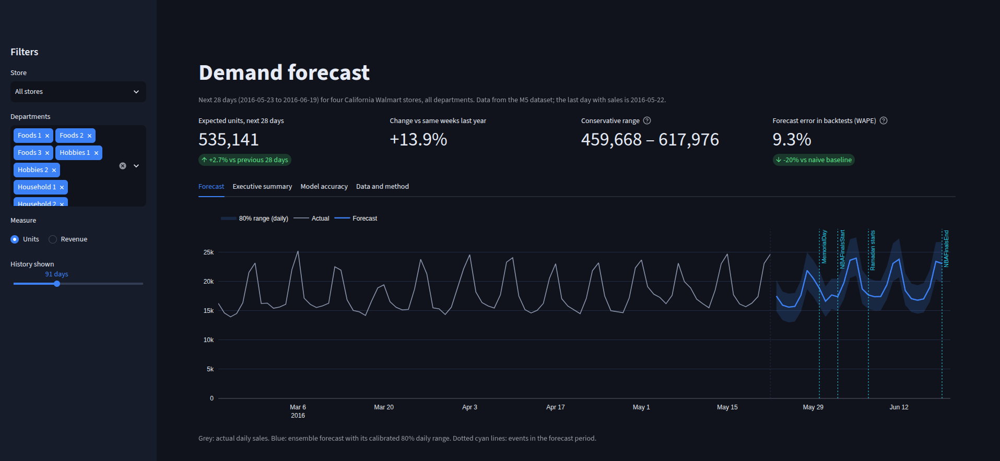
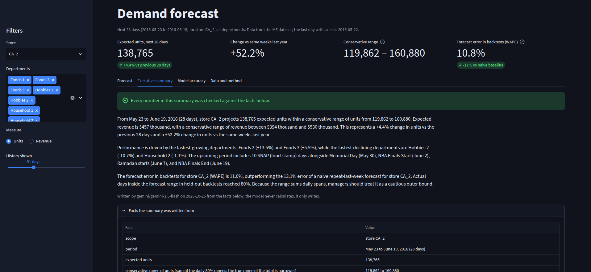
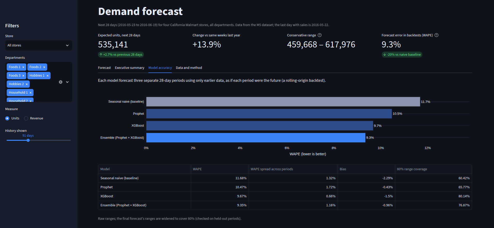

# Demand Forecasting with GenAI Executive Summaries

Forecasts 28 days of daily unit sales and revenue for every store and department of Walmart's
four California stores (M5 dataset), with Prophet and XGBoost tested against a seasonal-naive
baseline in a rolling backtest, calibrated prediction intervals, and plain-language executive
summaries written by an LLM from verified facts, all served in a Streamlit dashboard.

**Results**
- The ensemble of Prophet and XGBoost **cuts forecast error by 20%** against a naive
  repeat-last-week baseline (WAPE 11.7% -> 9.3%), and beats it in every store.
- Its **80% prediction ranges contain 80% of actual days** on held-out backtest periods, after
  calibration (77% before).
- **5 of 5 executive summaries verified:** every number in them matches a fact computed in SQL.

To set it up and run it, see **[RUNNING.md](RUNNING.md)**.



<table>
  <tr>
    <td width="50%"></td>
    <td width="50%"></td>
  </tr>
  <tr>
    <td><b>Executive summary.</b> Written by the LLM from facts computed in SQL; every number is checked, and the facts are shown alongside.</td>
    <td><b>Model accuracy.</b> Every model against the naive baseline in a rolling backtest, for any store and department selection.</td>
  </tr>
</table>

## How it works

```
M5 CSVs -> SQLite (store x department x day) -> features in SQL (window functions)
        -> backtest: seasonal naive | Prophet | XGBoost | ensemble   (3 x 28-day periods)
        -> 28-day ensemble forecast, intervals calibrated on the backtest, revenue
        -> facts computed in SQL -> LLM writes summaries -> number and completeness checks
        -> Streamlit dashboard
```

| Part | Technology |
|---|---|
| Storage and features | SQLite; features built with SQL window functions |
| Models | Prophet (one per series), XGBoost (one global model with quantile intervals), their average |
| Summaries | Gemini through the OpenAI-compatible API (any compatible provider, or a local model via Ollama) |
| Dashboard | Streamlit, Plotly |

## Results

Rolling-origin backtest: three 28-day periods (February 29 to May 22, 2016), 28 series,
each model trained only on data before its period.

| Model | WAPE | vs baseline | Spread across periods | Bias | 80% range coverage |
|---|---|---|---|---|---|
| Seasonal naive (baseline) | 11.7% | | 1.3% | -2.3% | 60% |
| Prophet | 10.5% | -10% | 1.7% | -0.4% | 66% |
| XGBoost | 9.7% | -17% | **0.7%** | -1.5% | **80%** |
| **Ensemble** | **9.3%** | **-20%** | 1.2% | -0.9% | 77% (80% after calibration) |

| Store | Ensemble WAPE | Baseline WAPE |
|---|---|---|
| CA_1 | 9.4% | 12.5% |
| CA_2 | 11.0% | 13.1% |
| CA_3 | **7.7%** | 9.8% |
| CA_4 | 10.6% | 12.5% |

By department, error ranges from 7.6% (Foods 3, the largest) to 23.5% (Hobbies 2, small and
erratic); full tables are in `results/backtest_summary.md`.

**Findings**
1. **The baseline is hard to beat at department level**, because a strong weekly rhythm
   dominates department totals; a 20% improvement is solid, not dramatic.
2. **XGBoost is the most reliable single model**: the most stable across periods, and its 80%
   ranges contain exactly 80% of actual days. **Prophet's ranges are too narrow** (66%), and
   Prophet lost to the baseline in one period and two departments.
3. **The ensemble wins because the models make different mistakes**: it is best overall and in
   5 of 7 departments, although Prophet alone is the weakest model.
4. **Difficulty follows stability**: CA_2, whose sales stepped up sharply in mid-2015 (from
   about 75,000 to over 100,000 units a month), is hardest; CA_3, the largest and steadiest
   store, is easiest.
5. The gap between the ensemble and XGBoost alone (9.3% vs 9.7%) is smaller than the spread
   across periods, so those two are statistically close; the gain over the baseline is clear.

**Example summary** (store CA_2, written by gemini-3.5-flash, verified):

> From May 23 to June 19, 2016, store CA_2 is expected to sell 138,765 units, generating $457
> thousand in expected revenue over the 28 days. [...] This represents a +4.4% change in units
> compared to the previous 28 days and a +52.2% change in units versus the same weeks last year.
>
> Department growth is driven by Foods 2 (+13.5%) and Foods 3 (+5.5%), while the sharpest
> declines are in Hobbies 2 (-10.7%) and Household 2 (-1.1%). [...]

The +52.2% is real: CA_2 sold about 71,000-79,000 units a month in March to May 2015 and over
100,000 from June 2015, so the same weeks last year fall before that step up.

## Limitations

- **Old data.** M5 ends on May 22, 2016, so the "future" is June 2016; the method, not the
  dates, is the point.
- **Department level only.** Single products sell nothing on most days and would need
  different models (for example, for intermittent demand).
- **Three backtest periods**, all in spring 2016; results in other seasons may differ.
- **The 28-day range in the summaries is conservative**: it is the sum of daily ranges, and
  daily errors partly cancel, so the true range of the total is narrower.
- **The summary model can change.** Google retires model versions (gemini-2.5-flash was no
  longer available to new keys), so the model is pinned in `.env` and recorded with each summary.

## Method

### Step 1: data into SQLite

Put the M5 zip from Kaggle (`m5-forecasting-accuracy.zip`) in `data/raw/`, then:

```bash
python ingest/load_m5.py        # data/demand.db
python scripts/check_llm.py     # checks the summary LLM (Gemini by default)
```

| Table | Contents |
|---|---|
| `calendar` | one row per day: weekday, month, year, Walmart week, events, SNAP days (California) |
| `daily_sales` | one row per store, department and day: units sold, revenue |
| `products` | number of products per store and department |

The summary LLM is reached through the OpenAI-compatible API, so the provider is a
setting: Gemini through Google AI Studio's free tier by default, or a local model through
Ollama (`LLM_PROVIDER=ollama`).

### Step 2: features in SQL

```bash
python ingest/build_features.py   # tables features and dept_prices
```

One row per store, department and date, including the 28 calendar days after the last
day with sales, which are the days to forecast. Built with SQL window functions over a grid
of every series and date. Sales-based features use only information at least 28 days old,
so they exist when forecasting 28 days ahead:

| Feature | Meaning |
|---|---|
| `lag_28`, `lag_35` | units on the same weekday 4 and 5 weeks earlier |
| `mean_7_lag28`, `mean_28_lag28` | mean units over the 7 and 28 days ending 28 days earlier |
| `lag_364` | units on the same weekday one year (52 weeks) earlier |
| `wday`, `month`, `year`, `day_of_month`, `is_weekend` | calendar |
| `is_event`, `event_type`, `event_name`, `snap` | holidays, sporting and cultural events, food-stamp days |
| `price_index` | mean of each product's shelf price relative to its own average price (below 1.0 = discounts); prices are set in advance, so this is known for future days |

The features were verified on synthetic data where each day's sales equal its day number,
so every lag and window average can be checked exactly, including that no feature crosses
from one series into another.

### Step 3: models and backtest

```bash
python forecast/backtest.py      # about 2-3 minutes; results in results/
```

| Model | How it forecasts |
|---|---|
| Seasonal naive | repeats the last observed week; the baseline any real model must beat |
| Prophet | one model per series: trend, weekly and yearly seasonality (multiplicative), calendar events as holidays (with the day before and after), SNAP days and the price index as regressors |
| XGBoost | one global model for all 28 series on the SQL features plus series identity; it predicts each day's sales relative to the series' recent 28-day level, so large and small departments are learned together; 10% and 90% quantile models give the interval |
| Ensemble | the mean of Prophet and XGBoost |

**Rolling-origin backtest.** Three 28-day periods are forecast as if each were the future:
the origin is the last known day minus 28, 56 and 84 days, and each model trains only on
data up to its origin. Scored with WAPE (total absolute error / total sales, the standard
retail measure), bias (over- or under-forecasting, which drives stock-outs or excess
stock), RMSE, and the coverage of the 80% prediction interval (ideal: about 0.80).

Results: `results/backtest_summary.md` (overall, by department, by fold),
`results/backtest_metrics.csv`, and every forecast in `results/backtest_predictions.parquet`.

### Step 4: the 28-day forecast

```bash
python forecast/predict.py      # needs results/ from forecast/backtest.py
```

Prophet and XGBoost are trained on all known days and averaged (the ensemble, the best model
in the backtest) to forecast the 28 days after the last day with sales, for all 28 series.

**Calibrated intervals.** The ensemble's raw 80% intervals cover less than 80% in the backtest,
so each side is widened by the smallest factor that reaches 80% on the backtest forecasts.
Fitting and checking that factor on the same data would flatter it, so the reported coverage
comes from leave-one-fold-out: the factor is fitted on two backtest periods and checked on the
third, for each period in turn (`results/interval_calibration.json`).

**Revenue** = forecast units x each series' price per unit over its last 28 days, adjusted by the
planned price change, since Walmart's prices (and so the price index) are known in advance.

Output: SQLite tables `forecasts` (units and revenue with intervals, the two model forecasts,
events and SNAP days) and `forecast_calibration`, plus `results/forecast.csv`.

XGBoost can train on an NVIDIA GPU with `XGB_DEVICE=cuda` in `.env`.

### Step 5: executive summaries (LLM)

```bash
python summaries/generate.py          # 5 summaries: all stores, then each store
python summaries/generate.py --force  # rewrite even if the facts have not changed
```

**The LLM never calculates.** Python computes every fact from SQL and formats each number:
forecast units and revenue with their range, the change against the previous 28 days and the
same weeks a year earlier, the departments growing and declining most, events and SNAP days in
the period, and the model's backtest accuracy. The LLM (Gemini by default, or a local model
through Ollama) only turns these facts into a three-paragraph summary for store managers.

Each store's summary uses that store's own backtest accuracy, and the forecast range is
described as conservative: it is the sum of the daily 80% ranges, while daily errors partly
cancel over 28 days, so the true range of the 28-day total is narrower.

**Checks.** Every number in a summary must match one of its facts (dates, years and small
counts excepted), and the summary must be complete: it must end with a full sentence and have a
reasonable length. If either check fails, the LLM gets one retry that names the problem; a
summary that still fails is stored with a visible warning rather than presented as reliable.
In testing, the checks caught invented figures, rounded figures, a store summary reusing the
all-store totals, and summaries cut off mid-sentence. The cut-offs came from the model's hidden
reasoning using up the output budget; the client now retries any reply that hits the output
limit with a larger budget.

Output: SQLite table `summaries`, with each summary's text, the facts it was written from,
the verification result, the provider and model, and a hash of the facts, so summaries are
only regenerated when the forecast changes.

### Step 6: dashboard (Streamlit)

```bash
streamlit run app/dashboard.py      # http://localhost:8501
```

| Part | Shows |
|---|---|
| Filters | store (all or one), departments, units or revenue, history length |
| KPIs | expected units or revenue for the next 28 days with the change vs the previous 28 days, change vs the same weeks last year, the conservative range, and backtest error vs the naive baseline |
| Forecast | recent actual sales, the forecast with its calibrated 80% daily range, events in the period; a department table sorted by change |
| Executive summary | the LLM summary for the selected store, its verification status, and the exact facts it was written from |
| Model accuracy | every model's WAPE, spread across periods, bias and interval coverage for the current selection, and backtest forecasts against actual sales |
| Data and method | forecast download (CSV) and a short description of the method |

The dashboard reads the database in read-only mode and caches queries.
